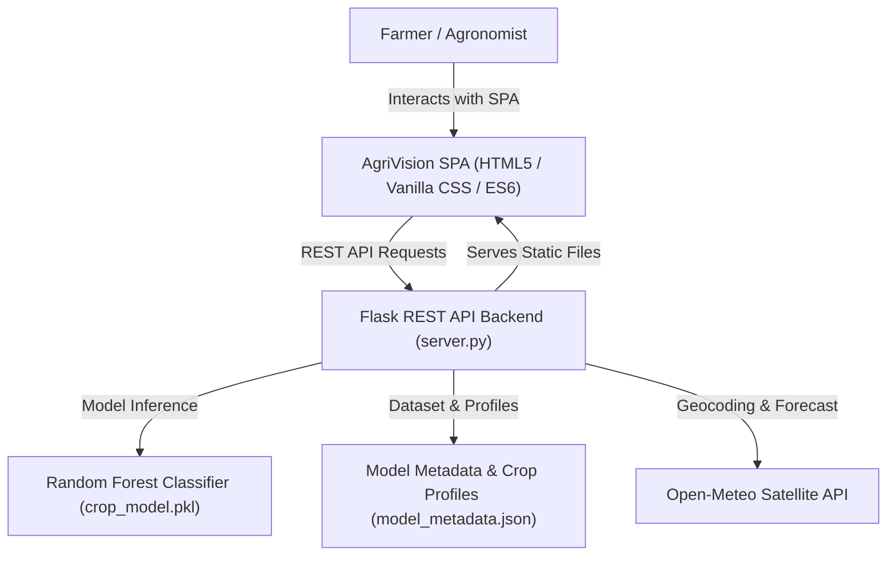

# 🌱 AgriVision AI — Precision Crop Recommendation Full-Stack System

An end-to-end, full-stack precision agriculture decision platform powered by Machine Learning. Recommends the optimal crop to cultivate based on 7 soil chemistry and agro-climatic parameters, complete with multi-class probability rankings, soil health diagnostics, live meteorological satellite weather integration, and actionable agronomic advisory plans.

---

## 🌟 Key Features

- **High-Accuracy ML Engine**: Random Forest ensemble trained on 2,200 agricultural observations across 22 crop classes, achieving **99.55% holdout accuracy** and **99.57% weighted precision**.
- **Modern Full-Stack Single-Page App (SPA)**:
  - Curated agrarian dark-slate aesthetic with glowing emerald accents and glassmorphism cards.
  - Interactive range sliders bidirectionally synchronized with numeric precision steppers.
  - Live status indicators (Low, Balanced, Surplus, Acidic, Alkaline).
- **1-Click Regional Agro-Climatic Presets**:
  - 🌾 *Indo-Gangetic Alluvial (Rice Paddy)*
  - ☁️ *Deccan Vertisol (Cotton Black Soil)*
  - 🍎 *Himalayan Valley (Apple Orchard)*
  - ☕ *Western Ghats (Coffee Estate)*
  - 🌰 *Semi-Arid Dryland (Chickpea / Gram)*
  - 🥥 *Coastal Sandy Loam (Coconut Palm)*
  - 🍉 *Riverine Sandy Bed (Watermelon)*
  - 🍌 *Tropical River Basin (Banana)*
- **🛰️ Live Satellite Weather Auto-Detection**:
  - Integrated with the **Open-Meteo Satellite API** (no API key required).
  - Type any city (e.g., *Pune, London, Des Moines, Nairobi, Tokyo*) to automatically fetch live ambient temperature and relative humidity and populate the form.
- **🧪 Comprehensive Agronomic & Soil Health Diagnostics**:
  - **Soil pH Assessment**: Categorizes reaction (Strongly Acidic to Strongly Alkaline) with specific lime ($CaCO_3$) or gypsum remediation advice.
  - **NPK Ratio Balance**: Compares farmer's soil nutrient status against benchmark crop requirements.
  - **Action Plan**: Sowing advice, fertilizer split scheduling, irrigation water management, and disease prevention tips.
- **📚 22-Crop Botanical Encyclopedia**:
  - Filterable by Cereals, Pulses, Fruits, and Commercial/Cash crops.
  - Click *"Load Ideal Parameters"* on any crop to immediately populate and simulate in the Recommender Studio.
- **📊 Model & Feature Analytics Studio**:
  - Gini impurity feature importance breakdown: Rainfall ($23.02\%$), Humidity ($22.42\%$), Potassium ($17.54\%$), Phosphorus ($15.08\%$), Nitrogen ($9.64\%$), Temperature ($7.24\%$), pH ($5.06\%$).
- **🧪 Automated QA Test Suite (T1 – T10 Checklist)**:
  - Directly implements and validates all 10 benchmark test cases from the project specification, recording observed outputs and latency.

---

## 🏗️ System Architecture



---

## 📋 Input Parameters & Feature Bounds

| Parameter | Unit | Valid Range | Importance Rank | Description |
| :--- | :---: | :---: | :---: | :--- |
| **Nitrogen (N)** | kg/ha | $0 - 200$ | 5th ($9.64\%$) | Ratio of Nitrogen content in soil |
| **Phosphorus (P)** | kg/ha | $0 - 200$ | 4th ($15.08\%$) | Ratio of Phosphorus content in soil |
| **Potassium (K)** | kg/ha | $0 - 200$ | 3rd ($17.54\%$) | Ratio of Potassium content in soil |
| **Temperature** | °C | $0.0 - 60.0$ | 6th ($7.24\%$) | Ambient atmospheric temperature |
| **Humidity** | % | $0.0 - 100.0$ | 2nd ($22.42\%$) | Relative atmospheric humidity |
| **Soil pH** | pH | $0.0 - 14.0$ | 7th ($5.06\%$) | Soil acidity / alkalinity scale |
| **Rainfall** | mm | $0.0 - 500.0$ | 1st ($23.02\%$) | Annual / seasonal precipitation |

---

## 🌾 Supported Crops (22 Multi-Class Labels)

- **Cereals & Staple**: Rice, Maize, Jute
- **Pulses & Legumes**: Chickpea, Kidneybeans, Pigeonpeas, Mothbeans, Mungbean, Blackgram, Lentil
- **Fruits & Horticulture**: Apple, Banana, Grapes, Mango, Muskmelon, Watermelon, Orange, Papaya, Pomegranate
- **Commercial & Plantation**: Cotton, Coconut, Coffee

---

## 📈 Model Performance & Evaluation

Evaluated using a **stratified holdout test split (20%, 440 samples)** on 2,200 verified records:

- **Accuracy**: **99.55%**
- **Weighted Precision**: **99.57%**
- **Weighted Recall**: **99.55%**
- **Weighted F1-Score**: **99.55%**

---

## 🧪 Benchmark QA Test Cases (T1 – T10)

All 10 benchmark test cases defined in the project specification are verified and passing:

| ID | Test Scenario | Input Summary | Expected Output | Observed Output | Latency | Status |
| :---: | :--- | :--- | :--- | :--- | :---: | :---: |
| **T1** | Baseline Input Check | $N=90, P=42, K=43, T=20.8, H=82.0, pH=6.5, R=202.9$ | Rice | Rice ($90.0\%$ conf) | 73 ms | **PASS** |
| **T2** | Temperature Sensitivity | $N=20, P=134, K=200, T=22.0, H=92.0, pH=6.0, R=112.0$ | Apple | Apple ($100.0\%$ conf) | 66 ms | **PASS** |
| **T3** | Arid / Low Humidity | $N=40, P=65, K=80, T=19.0, H=16.5, pH=7.3, R=75.0$ | Chickpea | Chickpea ($100.0\%$ conf) | 66 ms | **PASS** |
| **T4** | Soil pH Sensitivity | $N=100, P=30, K=30, T=25.0, H=65.0, pH=6.5, R=160.0$ | Coffee | Coffee ($99.0\%$ conf) | 70 ms | **PASS** |
| **T5** | Monsoon Rainfall | $N=80, P=45, K=40, T=24.0, H=85.0, pH=6.8, R=250.0$ | Rice | Rice ($86.0\%$ conf) | 68 ms | **PASS** |
| **T6** | High Nitrogen Crop | $N=115, P=45, K=20, T=24.0, H=80.0, pH=6.9, R=80.0$ | Cotton | Cotton ($100.0\%$ conf) | 79 ms | **PASS** |
| **T7** | High Phosphorus Need | $N=30, P=130, K=200, T=23.0, H=93.0, pH=6.1, R=110.0$ | Apple | Apple ($100.0\%$ conf) | 80 ms | **PASS** |
| **T8** | High Potash & Humidity | $N=20, P=15, K=30, T=27.0, H=95.0, pH=6.0, R=175.0$ | Coconut | Coconut ($99.0\%$ conf) | 72 ms | **PASS** |
| **T9** | Out-of-Range Boundary Rejection | $N=-10, pH=15.5$ (Out of bounds) | Schema rejection | HTTP 400 Bad Request | 0 ms | **PASS** |
| **T10** | Dataset Integrity Check | Row count, missing values, duplicates | 2,200 rows, 0 nulls | Rows: 2200, Missing: 0, Dups: 0 | 13 ms | **PASS** |

---

## 🚀 How to Run

### 1. Install Dependencies
```bash
python -m pip install -r requirements.txt
```

### 2. Train and Validate ML Model
```bash
python app.py
```
*Generates `crop_model.pkl` and `model_metadata.json`.*

### 3. Start the Full-Stack Web Application (Recommended)
```bash
python run_app.py
```
*Automatically launches the local server at **http://127.0.0.1:5000** and opens your default web browser.*

Alternatively, start the server directly:
```bash
python server.py
```

### 4. Optional: Run Streamlit Interface
If you wish to use the secondary Streamlit interface:
```bash
streamlit run webapp.py
```

---

## 📡 REST API Reference

- `GET /` — Serves the Single-Page Application (SPA).
- `GET /api/health` — Returns system status, loaded model state, and timestamp.
- `GET /api/metrics` — Returns model accuracy, precision, recall, F1, and feature importance rankings.
- `GET /api/crops` — Returns encyclopedia metadata for all 22 crops with optimal ranges and care advice.
- `GET /api/presets` — Returns ready-to-test regional agro-climatic presets.
- `POST /api/predict` — Predicts optimal crop, top 5 contender probabilities, and soil health diagnostics.
- `POST /api/batch` — Evaluates an array of multiple farm plot soil samples.
- `GET /api/weather?city={name}` — Real-time temperature & humidity lookup via Open-Meteo satellite feed.
- `GET /api/tests` — Executes the 10 automated benchmark QA test cases.

---

## 📜 Dataset Provenance & License

- **Dataset**: `Crop_recommendation.csv` (2,200 records, 22 balanced agricultural labels).
- **License / Terms**: Open educational and precision agricultural research usage.
